# EDA 보고서 — Credit Risk & Loan Portfolio

> **⚠️ 합성(synthetic) 테스트 데이터 기반 결과 — 실제 Home Credit 분석 결과 아님**
>
> `raw.columns_description`의 설명이 `[synthetic]`으로 시작하여 합성 데이터로 자동 판별되었다. 아래 수치는 파이프라인 검증용이며 해석에 사용하지 않는다.

- 생성 시각: 2026-10-15 18:22 UTC · 실행 시간: 12.0s
- 분석 대상: `analytics.customer_feature_mart`의 train 고객 30,000명 (1고객 1행), 보조 테이블은 SQL 집계 결과만 사용
- 용어: TARGET 평균 = **관측 상환곤란율 (Observed Difficulty Rate)** (실제 부도율·IFRS 9 부도율 아님), AMT_CREDIT = **Exposure Proxy (AMT_CREDIT)**
- 모든 관계는 연관(association)이며 인과(causation)를 의미하지 않는다. 학습 표본 결과를 실제 은행 전체 고객군에 일반화하지 않는다.
- 성별·연령·가족 관련 속성은 **기술통계 목적**으로만 제시하며 승인 기준으로 사용하지 않는다 (spec §19).

## 1. 핵심 인사이트 (Power BI 페이지 반영용)

효과크기(|rank-biserial r|, Cramér's V) 또는 Exposure 집중도 순으로 자동 선정되었다. 공정성 민감 속성은 후보에서 제외했다.

**I01. cc_utilization_mean: TARGET=1 고객군에서 더 높은 값 분포**  
TARGET=1 고객군의 `cc_utilization_mean` 중앙값은 0.418로 TARGET=0 고객군(0.318)보다 높게 관측된다 (해당 이력 보유 고객 기준). rank-biserial r = +0.440 (효과크기 중간).  
- 지표: rank-biserial r = 0.440 · Power BI: Page 3. Repayment & Delinquency
- 근거: 그림 `reports/figures/eda_effect_sizes.png` · 함수 `credit_risk.eda.target_comparison` · SQL `SELECT target, cc_utilization_mean FROM analytics.customer_feature_mart WHERE source = 'train'`
- 주의: 연관(association) 관측이며 인과관계를 의미하지 않음. 학습 표본 밖으로 일반화하지 않음. 합성 테스트 데이터 기반 수치.

**I02. ext_source_mean: TARGET=1 고객군에서 더 낮은 값 분포**  
TARGET=1 고객군의 `ext_source_mean` 중앙값은 0.323로 TARGET=0 고객군(0.517)보다 낮게 관측된다. rank-biserial r = -0.430 (효과크기 중간).  
- 지표: rank-biserial r = -0.430 · Power BI: Page 2. Risk Segmentation
- 근거: 그림 `reports/figures/eda_effect_sizes.png` · 함수 `credit_risk.eda.target_comparison` · SQL `SELECT target, ext_source_mean FROM analytics.customer_feature_mart WHERE source = 'train'`
- 주의: 연관(association) 관측이며 인과관계를 의미하지 않음. 학습 표본 밖으로 일반화하지 않음. 합성 테스트 데이터 기반 수치.

**I03. pos_dpd_month_ratio: TARGET=1 고객군에서 더 높은 값 분포**  
TARGET=1 고객군의 `pos_dpd_month_ratio` 중앙값은 0.053로 TARGET=0 고객군(0.005)보다 높게 관측된다 (해당 이력 보유 고객 기준). rank-biserial r = +0.284 (효과크기 작음).  
- 지표: rank-biserial r = 0.284 · Power BI: Page 3. Repayment & Delinquency
- 근거: 그림 `reports/figures/eda_effect_sizes.png` · 함수 `credit_risk.eda.target_comparison` · SQL `SELECT target, pos_dpd_month_ratio FROM analytics.customer_feature_mart WHERE source = 'train'`
- 주의: 연관(association) 관측이며 인과관계를 의미하지 않음. 학습 표본 밖으로 일반화하지 않음. 합성 테스트 데이터 기반 수치.

**I04. bur_bb_dpd_month_ratio: TARGET=1 고객군에서 더 높은 값 분포**  
TARGET=1 고객군의 `bur_bb_dpd_month_ratio` 중앙값은 0.056로 TARGET=0 고객군(0.026)보다 높게 관측된다 (해당 이력 보유 고객 기준). rank-biserial r = +0.274 (효과크기 작음).  
- 지표: rank-biserial r = 0.274 · Power BI: Page 3. Repayment & Delinquency
- 근거: 그림 `reports/figures/eda_effect_sizes.png` · 함수 `credit_risk.eda.target_comparison` · SQL `SELECT target, bur_bb_dpd_month_ratio FROM analytics.customer_feature_mart WHERE source = 'train'`
- 주의: 연관(association) 관측이며 인과관계를 의미하지 않음. 학습 표본 밖으로 일반화하지 않음. 합성 테스트 데이터 기반 수치.

**I05. inst_late_ratio_band 구간별 관측 상환곤란율 차이**  
`inst_late_ratio_band` 구간별 관측 상환곤란율 (Observed Difficulty Rate)은 최저 5.3%(`0-5%`, n=2,693)에서 최고 19.7%(`>20%`, n=2,937)까지 분포한다 (전체 9.1%, Cramér's V = 0.132).  
- 지표: Cramér's V = 0.132 · Power BI: Page 3. Repayment & Delinquency
- 근거: 그림 `reports/figures/eda_rate_inst_late_ratio_band.png` · 함수 `credit_risk.eda.binned_risk` · SQL `SELECT target, inst_late_ratio, amt_credit FROM analytics.customer_feature_mart WHERE source = 'train'`
- 주의: 연관(association) 관측이며 인과관계를 의미하지 않음. 학습 표본 밖으로 일반화하지 않음. 합성 테스트 데이터 기반 수치.

**I06. bureau_worst_status 구간별 관측 상환곤란율 차이**  
`bureau_worst_status` 구간별 관측 상환곤란율 (Observed Difficulty Rate)은 최저 6.1%(`Status 0`, n=8,761)에서 최고 14.8%(`Status 4`, n=946)까지 분포한다 (전체 9.1%, Cramér's V = 0.088).  
- 지표: Cramér's V = 0.088 · Power BI: Page 3. Repayment & Delinquency
- 근거: 그림 `reports/figures/eda_rate_bureau_worst_status.png` · 함수 `credit_risk.eda.binned_risk` · SQL `SELECT target, bur_bb_worst_status, amt_credit FROM analytics.customer_feature_mart WHERE source = 'train'`
- 주의: 연관(association) 관측이며 인과관계를 의미하지 않음. 학습 표본 밖으로 일반화하지 않음. 합성 테스트 데이터 기반 수치.

**I07. prev_days_since_last_refused 이력 부재(structural NULL)와 관측 상환곤란율**  
`prev_days_since_last_refused` 이력 부재(structural NULL) 고객(44.5%)의 관측 상환곤란율 (Observed Difficulty Rate)은 7.6%, 값이 있는 고객은 10.2%로 관측된다 (phi = 0.044).  
- 지표: Cramér's V (phi) = 0.044 · Power BI: Page 3. Repayment & Delinquency
- 근거: 그림 `reports/figures/eda_missingness_vs_target.png` · 함수 `credit_risk.eda.missingness_vs_target` · SQL `SELECT (prev_days_since_last_refused IS NULL) AS is_null, count(*), avg(target) FROM analytics.customer_feature_mart WHERE source = 'train' GROUP BY 1`
- 주의: 연관(association) 관측이며 인과관계를 의미하지 않음. 학습 표본 밖으로 일반화하지 않음. 합성 테스트 데이터 기반 수치.

**I08. prev_last_status 범주별 관측 상환곤란율 차이**  
`prev_last_status`와 TARGET의 연관은 Cramér's V = 0.038로 관측된다. 최고 구간은 `Refused` (11.3%, 고객 비중 18.6%).  
- 지표: Cramér's V = 0.038 · Power BI: Page 3. Repayment & Delinquency
- 근거: 그림 `reports/figures/eda_categorical_frequency.png` · 함수 `credit_risk.eda.categorical_tests` · SQL `SELECT target, prev_last_status FROM analytics.customer_feature_mart WHERE source = 'train'`
- 주의: 연관(association) 관측이며 인과관계를 의미하지 않음. 학습 표본 밖으로 일반화하지 않음. 합성 테스트 데이터 기반 수치.

**I09. 외부점수 하위 20% 고객의 Exposure·상환곤란 비중**  
`ext_source_mean` 하위 20% 고객은 Exposure Proxy (AMT_CREDIT)의 19.8%, 관측 상환곤란 건의 45.7%를 차지하며, 이 구간의 관측 상환곤란율 (Observed Difficulty Rate)은 20.7% (나머지 6.1%)로 관측된다.  
- 지표: exposure share of lowest-score tail = 0.198 · Power BI: Page 1. Executive Portfolio Overview / Page 2. Risk Segmentation
- 근거: 그림 `reports/figures/eda_exposure_ext_source_quintile.png` · 함수 `credit_risk.eda.score_tail_concentration` · SQL `SELECT target, ext_source_mean, amt_credit FROM analytics.customer_feature_mart WHERE source = 'train'`
- 주의: 연관(association) 관측이며 인과관계를 의미하지 않음. 학습 표본 밖으로 일반화하지 않음. 합성 테스트 데이터 기반 수치.

**I10. income_band 기준 위험 상위 세그먼트의 Exposure 비중**  
`income_band` 기준 관측 상환곤란율 (Observed Difficulty Rate)이 전체의 1.2배 이상인 세그먼트(< 100K)는 고객의 18.5%, Exposure Proxy (AMT_CREDIT)의 18.5%, 관측 상환곤란 건의 23.5%를 차지한다. Exposure 비중과 고객 비중은 비슷한 수준이다.  
- 지표: exposure share of elevated-rate segments = 0.185 · Power BI: Page 1. Executive Portfolio Overview / Page 2. Risk Segmentation
- 근거: 그림 `reports/figures/eda_exposure_income_band.png` · 함수 `credit_risk.eda.exposure_concentration` · SQL `SELECT target, amt_income_total, amt_credit FROM analytics.customer_feature_mart WHERE source = 'train'`
- 주의: 연관(association) 관측이며 인과관계를 의미하지 않음. 학습 표본 밖으로 일반화하지 않음. 합성 테스트 데이터 기반 수치.

## 2. 테이블 인벤토리 (행·열·용량·키·결측)

행 수와 컬럼별 결측률은 PostgreSQL에서 `count(*)`/`count(col)`로 집계했다 (대형 원천 테이블을 pandas로 적재하지 않음). 키 중복은 최신 `audit.data_quality_result`의 `key_unique` 결과를 재사용하고, 없으면 SQL로 계산했다.

| table | rows | cols | size (MB) | key | key dup | mean null | cols null>60% | top null columns |
|---|---|---|---|---|---|---|---|---|
| raw.application_train | 30,000 | 122 | 25.5 | sk_id_curr | 0 | 24.2% | 1 | own_car_age (66.1%), nonlivingarea_avg (58.1%), livingapartments_medi (58.1%), floorsmax_avg (58.1%), years_beginexpluatation_mode (58.0%) |
| raw.application_test | 6,000 | 121 | 5.1 | sk_id_curr | 0 | 23.9% | 1 | own_car_age (66.9%), elevators_mode (57.2%), nonlivingarea_medi (57.1%), floorsmax_medi (57.0%), nonlivingapartments_medi (57.0%) |
| raw.bureau | 172,878 | 17 | 28.5 | sk_id_bureau | 0 | 13.3% | 2 | amt_annuity (70.1%), amt_credit_max_overdue (65.0%), days_enddate_fact (37.0%), amt_credit_sum_limit (33.8%), amt_credit_sum_debt (15.0%) |
| raw.bureau_balance | 1,246,315 | 3 | 62.5 | sk_id_bureau,months_balance | 0 | 0.0% | 0 | - |
| raw.previous_application | 156,838 | 37 | 48.5 | sk_id_prev | 0 | 18.0% | 2 | rate_interest_primary (99.7%), rate_interest_privileged (99.7%), name_type_suite (57.0%), rate_down_payment (53.9%), amt_down_payment (53.8%) |
| raw.pos_cash_balance | 798,666 | 8 | 71.6 | - | - | 0.0% | 0 | - |
| raw.credit_card_balance | 144,959 | 23 | 29.5 | - | - | 6.8% | 0 | amt_payment_current (20.2%), cnt_drawings_other_current (20.1%), cnt_drawings_atm_current (20.1%), amt_drawings_atm_current (20.0%), amt_drawings_pos_current (20.0%) |
| raw.installments_payments | 647,585 | 8 | 57.5 | - | - | 0.0% | 0 | days_entry_payment (0.0%) |
| raw.columns_description | 218 | 5 | 0.0 | - | - | 18.9% | 1 | special (94.5%) |
| analytics.customer_feature_mart | 36,000 | 272 | 71.1 | sk_id_curr | 0 | 22.4% | 25 | prev_rate_interest_primary_mean (98.7%), prev_rate_interest_privileged_max (98.7%), cc_atm_drawings_mean (73.5%), cc_months (73.5%), cc_card_count (73.5%) |

데이터 품질 점검 결과(audit, 최신 결과 기준): analytics/pass 6건, mart/pass 14건, model/pass 13건, raw/pass 63건, raw/warn 4건, staging/pass 34건

## 3. TARGET 불균형

- TARGET=1: 2,716명, TARGET=0: 27,284명
- 관측 상환곤란율 (Observed Difficulty Rate): **9.05%** (95% Wilson CI 8.73% – 9.38%)
- 불균형 비율 (0:1) = 10.0 : 1 → 모델링 시 accuracy 대신 ROC-AUC/PR-AUC, stratified split, class weight 검토 필요

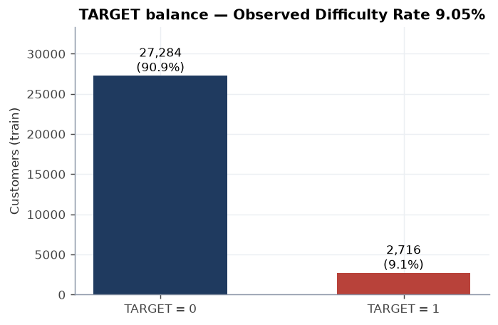

`reports/figures/eda_target_balance.png`

## 4. 주요 수치형 변수 분포와 극단값

극단값 = Q1 − 3·IQR 미만 또는 Q3 + 3·IQR 초과(far outlier). 삭제하지 않고 분포 왜곡 정도만 기록한다.

| feature | null | median | p1 | p99 | max | skew | far outlier |
|---|---|---|---|---|---|---|---|
| amt_income_total | 0.0% | 154,350 | 50,850.00 | 485,104 | 1,056,600 | 1.65 | 0.66% |
| amt_credit | 0.0% | 487,250 | 121,000 | 1,963,015 | 4,050,000 | 2.15 | 1.07% |
| amt_annuity | 0.0% | 20,634.10 | 4,204.65 | 110,784 | 301,624 | 2.65 | 1.61% |
| amt_goods_price | 0.1% | 439,000 | 108,000 | 1,797,520 | 3,809,000 | 2.17 | 1.13% |
| credit_income_ratio | 0.0% | 3.15 | 0.52 | 18.98 | 68.88 | 3.25 | 1.90% |
| annuity_income_ratio | 0.0% | 0.13 | 0.02 | 1.01 | 3.73 | 4.11 | 2.42% |
| credit_annuity_ratio | 0.0% | 24.94 | 10.31 | 39.70 | 40.00 | 0.01 | 0.00% |
| goods_credit_ratio | 0.1% | 0.90 | 0.80 | 1.00 | 1.00 | -0.00 | 0.00% |
| income_per_person | 0.0% | 75,750.00 | 19,124.55 | 334,350 | 1,056,600 | 2.42 | 1.43% |
| age_years | 0.0% | 43.83 | 21.00 | 69.00 | 69.00 | 0.05 | 0.00% |
| employment_years | 17.8% | 4.34 | 0.07 | 25.93 | 49.65 | 1.65 | 0.50% |
| ext_source_1 | 56.3% | 0.50 | 0.04 | 0.96 | 0.96 | -0.01 | 0.00% |
| ext_source_2 | 0.2% | 0.50 | 0.05 | 0.95 | 0.96 | 0.00 | 0.00% |
| ext_source_3 | 20.1% | 0.50 | 0.05 | 0.95 | 0.96 | -0.01 | 0.00% |
| ext_source_mean | 0.0% | 0.50 | 0.08 | 0.92 | 0.96 | -0.00 | 0.00% |
| cnt_children | 0.0% | 0.00 | 0.00 | 2.00 | 5.00 | 1.51 | 0.00% |
| cnt_fam_members | 0.0% | 2.00 | 1.00 | 4.00 | 7.00 | 0.67 | 0.00% |
| region_rating_client | 0.0% | 2.00 | 1.00 | 3.00 | 3.00 | -0.00 | n/a |
| region_population_relative | 0.0% | 0.04 | 0.00 | 0.07 | 0.07 | -0.02 | 0.00% |
| bur_count | 14.4% | 5.00 | 1.00 | 12.00 | 18.00 | 0.46 | 0.02% |
| bur_active_count | 14.4% | 2.00 | 0.00 | 6.00 | 9.00 | 0.68 | 0.00% |
| bur_active_debt_credit_ratio | 29.0% | 0.44 | 0.01 | 0.97 | 1.00 | 0.14 | 0.00% |
| bur_overdue_now_count | 14.4% | 0.00 | 0.00 | 1.00 | 3.00 | 3.87 | n/a |
| bur_day_overdue_max | 14.4% | 0.00 | 0.00 | 104.00 | 119.00 | 4.58 | n/a |
| bur_bb_dpd_month_ratio | 21.1% | 0.03 | 0.00 | 0.23 | 0.67 | 2.49 | 0.58% |
| prev_count | 6.0% | 4.00 | 1.00 | 10.00 | 16.00 | 0.57 | 0.01% |
| prev_refused_ratio | 6.0% | 0.17 | 0.00 | 1.00 | 1.00 | 1.25 | 0.00% |
| prev_approved_ratio | 6.0% | 0.60 | 0.00 | 1.00 | 1.00 | -0.35 | 0.00% |
| inst_late_ratio | 13.2% | 0.08 | 0.00 | 0.43 | 1.00 | 1.69 | 0.20% |
| inst_severe_late_ratio | 13.2% | 0.03 | 0.00 | 0.29 | 0.67 | 2.38 | 0.87% |
| inst_dpd_max | 13.2% | 33.00 | 0.00 | 59.00 | 59.00 | -0.17 | 0.00% |
| inst_payment_ratio_mean | 13.2% | 0.99 | 0.85 | 1.00 | 1.00 | -2.95 | 1.01% |
| inst_underpaid_ratio | 13.2% | 0.04 | 0.00 | 0.31 | 1.00 | 2.31 | 0.46% |
| pos_dpd_max | 13.2% | 6.00 | 0.00 | 89.00 | 89.00 | 0.60 | 0.00% |
| pos_dpd_month_ratio | 13.2% | 0.02 | 0.00 | 0.25 | 1.00 | 2.79 | 0.98% |
| cc_utilization_mean | 73.5% | 0.32 | 0.16 | 0.66 | 0.83 | 0.92 | 0.05% |
| cc_dpd_max | 73.5% | 0.00 | 0.00 | 58.00 | 59.00 | 1.69 | 16.49% |

왜도 |skew| ≥ 2인 변수: `bur_day_overdue_max` (4.6), `annuity_income_ratio` (4.1), `bur_overdue_now_count` (3.9), `credit_income_ratio` (3.2), `pos_dpd_month_ratio` (2.8), `amt_annuity` (2.6), `bur_bb_dpd_month_ratio` (2.5), `income_per_person` (2.4), `inst_severe_late_ratio` (2.4), `inst_underpaid_ratio` (2.3), `amt_goods_price` (2.2), `amt_credit` (2.1), `inst_payment_ratio_mean` (-3.0) → 금액형은 log 변환/robust 통계를 우선한다.

`DAYS_EMPLOYED` sentinel(365243) 고객: 5,348명 (17.8%), 이 그룹의 관측 상환곤란율 (Observed Difficulty Rate) 8.6% (나머지 9.2%). `employment_years`에서는 결측 처리되고 `days_employed_anom` 플래그로 분리되어 있다.

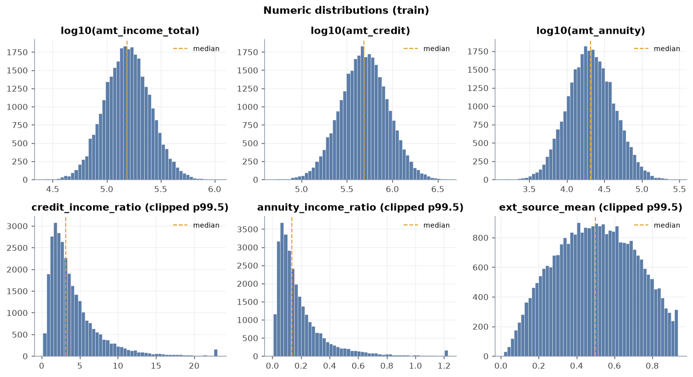

`reports/figures/eda_numeric_distributions.png`

## 5. 범주형 변수 빈도와 희소 범주

희소 범주 = 고객 비중 1% 미만.

| feature | levels | null | top level | top share | rare levels | rare share | rare examples |
|---|---|---|---|---|---|---|---|
| name_contract_type | 2 | 0.0% | Cash loans | 90.3% | 0 | 0.00% | - |
| code_gender ⚖️ | 2 | 0.0% | F | 65.5% | 0 | 0.00% | - |
| flag_own_car | 2 | 0.0% | N | 66.1% | 0 | 0.00% | - |
| flag_own_realty | 2 | 0.0% | Y | 68.9% | 0 | 0.00% | - |
| name_type_suite | 5 | 1.7% | Unaccompanied | 80.2% | 2 | 1.46% | Children, Other_B |
| name_income_type | 6 | 0.0% | Working | 51.7% | 2 | 0.09% | Unemployed, Student |
| name_education_type | 5 | 0.0% | Secondary / secondary special | 71.1% | 1 | 0.06% | Academic degree |
| name_family_status ⚖️ | 5 | 0.0% | Married | 64.5% | 0 | 0.00% | - |
| name_housing_type | 6 | 0.0% | House / apartment | 88.8% | 2 | 1.29% | Office apartment, Co-op apartment |
| occupation_type | 18 | 43.2% | IT staff | 3.4% | 0 | 0.00% | - |
| organization_type | 16 | 0.0% | XNA | 17.8% | 0 | 0.00% | - |
| weekday_appr_process_start | 7 | 0.0% | FRIDAY | 14.6% | 0 | 0.00% | - |
| prev_last_status | 4 | 6.0% | Approved | 56.7% | 0 | 0.00% | - |

⚖️ = 공정성 민감 속성 (기술통계 전용).

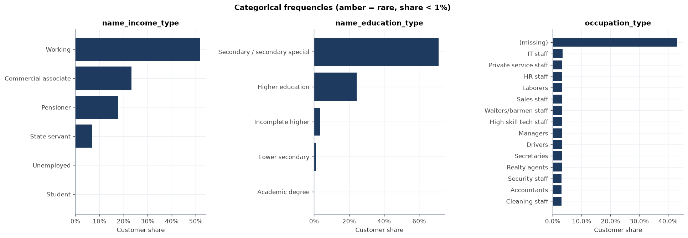

`reports/figures/eda_categorical_frequency.png`

## 6. TARGET별 소득·대출액·Annuity·비율 Feature 비교

중앙값과 Mann–Whitney U의 rank-biserial r(양수 = TARGET=1에서 큼)을 보고한다. 상세 검정표는 `reports/statistical_analysis.md` 참조.

| feature | median (T=1) | median (T=0) | rank-biserial r | effect |
|---|---|---|---|---|
| ext_source_mean | 0.323 | 0.517 | -0.430 | 중간 |
| ext_source_3 | 0.309 | 0.522 | -0.395 | 중간 |
| ext_source_2 | 0.317 | 0.519 | -0.369 | 중간 |
| ext_source_1 | 0.319 | 0.520 | -0.347 | 중간 |
| region_rating_client | 2.000 | 2.000 | +0.219 | 작음 |
| age_years ⚖️ | 41.622 | 44.064 | -0.120 | 작음 |
| amt_income_total | 143,550 | 155,250 | -0.091 | 무시할 수준 |
| income_per_person | 70,425.000 | 76,275.000 | -0.075 | 무시할 수준 |
| credit_income_ratio | 3.371 | 3.126 | +0.059 | 무시할 수준 |
| annuity_income_ratio | 0.142 | 0.133 | +0.044 | 무시할 수준 |
| credit_annuity_ratio | 25.140 | 24.915 | +0.011 | 무시할 수준 |
| cnt_children ⚖️ | 0.000 | 0.000 | +0.010 | 무시할 수준 |
| region_population_relative | 0.037 | 0.037 | +0.008 | 무시할 수준 |
| cnt_fam_members ⚖️ | 2.000 | 2.000 | +0.008 | 무시할 수준 |
| amt_annuity | 20,586.200 | 20,640.800 | -0.007 | 무시할 수준 |
| goods_credit_ratio | 0.899 | 0.900 | -0.006 | 무시할 수준 |
| amt_credit | 488,000 | 487,000 | +0.003 | 무시할 수준 |
| employment_years | 4.375 | 4.334 | -0.002 | 무시할 수준 |
| amt_goods_price | 439,000 | 439,000 | +0.002 | 무시할 수준 |

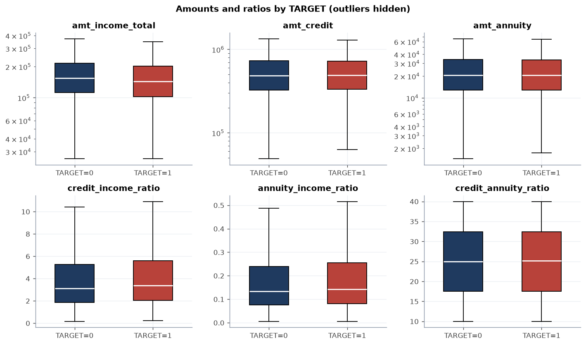

`reports/figures/eda_target_boxplots.png`

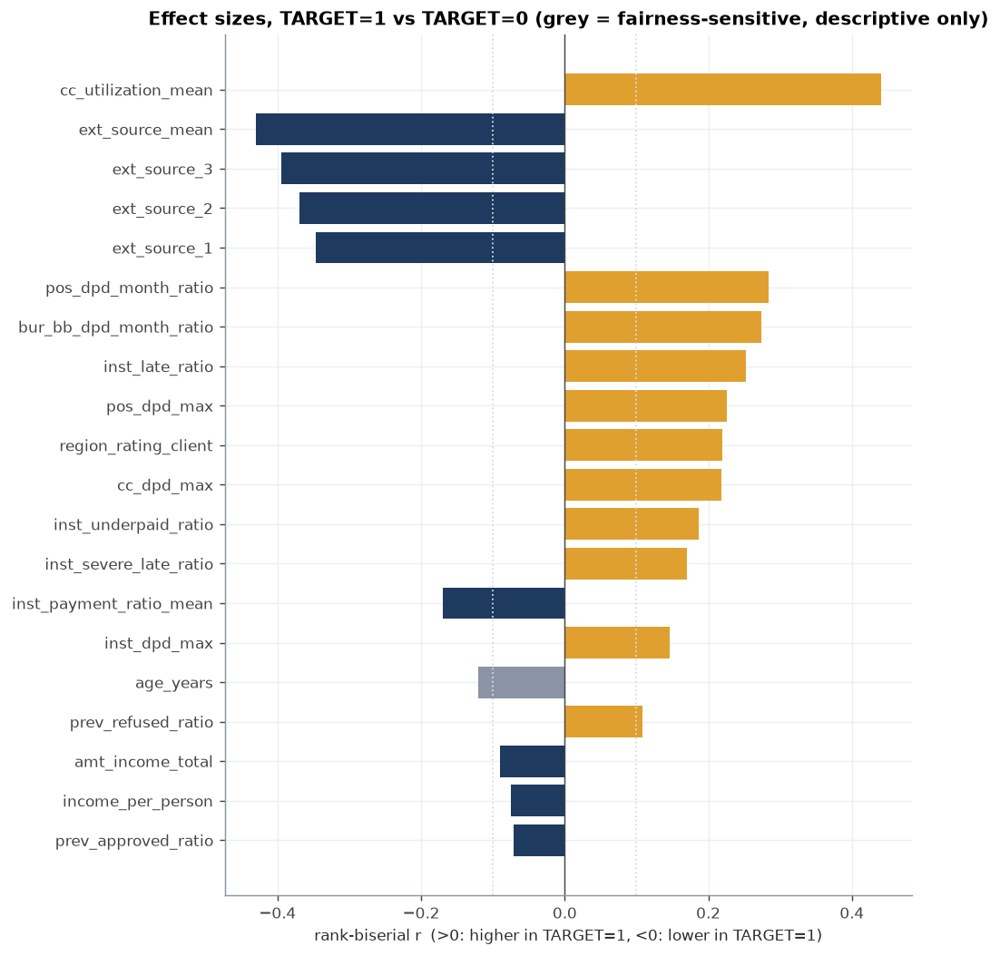

`reports/figures/eda_effect_sizes.png`

## 7. 연령·고용기간·외부점수와 관측 상환곤란율

### age_band (⚖️ 공정성 민감 — 기술통계 전용, 승인 기준 사용 금지)

Cramér's V = 0.060

| 구간 | n | TARGET=1 | rate | 95% CI low | 95% CI high | 고객 비중 | Exposure 비중 |
|---|---|---|---|---|---|---|---|
| 18-25 | 1,842 | 247 | 13.41% | 11.93% | 15.04% | 6.1% | 6.1% |
| 25-35 | 5,195 | 551 | 10.61% | 9.80% | 11.47% | 17.3% | 17.2% |
| 35-45 | 9,136 | 875 | 9.58% | 8.99% | 10.20% | 30.5% | 30.5% |
| 45-55 | 8,479 | 686 | 8.09% | 7.53% | 8.69% | 28.3% | 28.0% |
| 55-65 | 4,116 | 281 | 6.83% | 6.10% | 7.64% | 13.7% | 14.0% |
| 65-100 | 1,232 | 76 | 6.17% | 4.96% | 7.65% | 4.1% | 4.1% |

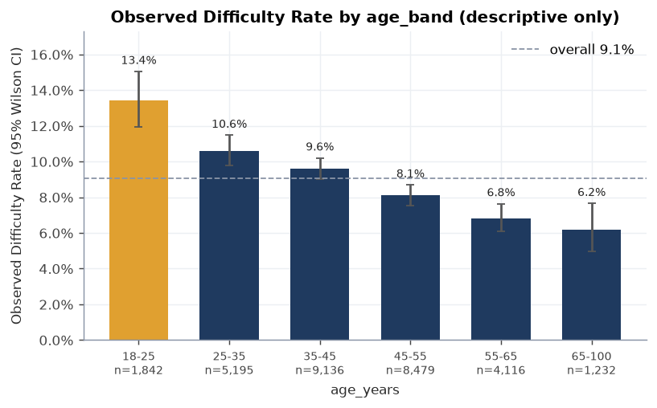

`reports/figures/eda_rate_age_band.png`

### income_band

Cramér's V = 0.049

| 구간 | n | TARGET=1 | rate | 95% CI low | 95% CI high | 고객 비중 | Exposure 비중 |
|---|---|---|---|---|---|---|---|
| < 100K | 5,557 | 639 | 11.50% | 10.69% | 12.36% | 18.5% | 18.5% |
| 100K-150K | 8,735 | 820 | 9.39% | 8.79% | 10.02% | 29.1% | 29.2% |
| 150K-200K | 6,802 | 560 | 8.23% | 7.60% | 8.91% | 22.7% | 22.6% |
| 200K-300K | 6,330 | 532 | 8.40% | 7.75% | 9.11% | 21.1% | 21.1% |
| 300K+ | 2,576 | 165 | 6.41% | 5.52% | 7.42% | 8.6% | 8.6% |

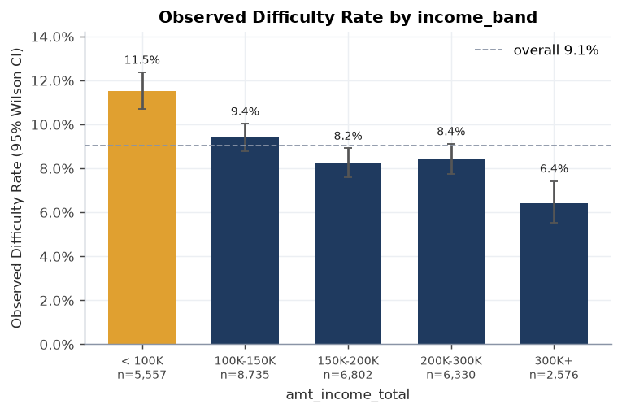

`reports/figures/eda_rate_income_band.png`

### employment_band

Cramér's V = 0.021

| 구간 | n | TARGET=1 | rate | 95% CI low | 95% CI high | 고객 비중 | Exposure 비중 |
|---|---|---|---|---|---|---|---|
| <1y | 3,472 | 312 | 8.99% | 8.08% | 9.98% | 11.6% | 11.5% |
| 1-3y | 5,473 | 475 | 8.68% | 7.96% | 9.45% | 18.2% | 18.2% |
| 3-5y | 4,610 | 465 | 10.09% | 9.25% | 10.99% | 15.4% | 15.4% |
| 5-10y | 6,224 | 567 | 9.11% | 8.42% | 9.85% | 20.7% | 20.9% |
| 10-20y | 4,104 | 385 | 9.38% | 8.53% | 10.31% | 13.7% | 13.6% |
| 20y+ | 769 | 53 | 6.89% | 5.31% | 8.91% | 2.6% | 2.5% |
| Sentinel 365243 | 5,348 | 459 | 8.58% | 7.86% | 9.36% | 17.8% | 17.8% |

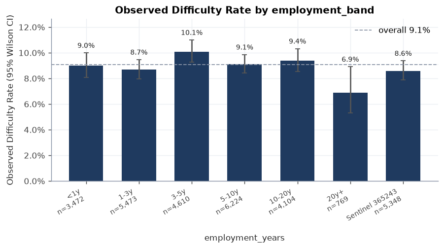

`reports/figures/eda_rate_employment_band.png`

### ext_source_decile

Cramér's V = 0.232

| 구간 | n | TARGET=1 | rate | 95% CI low | 95% CI high | 고객 비중 | Exposure 비중 |
|---|---|---|---|---|---|---|---|
| D1 | 2,999 | 744 | 24.81% | 23.30% | 26.39% | 10.0% | 9.8% |
| D2 | 2,999 | 497 | 16.57% | 15.28% | 17.95% | 10.0% | 10.1% |
| D3 | 2,999 | 352 | 11.74% | 10.63% | 12.94% | 10.0% | 10.2% |
| D4 | 2,999 | 263 | 8.77% | 7.81% | 9.84% | 10.0% | 9.9% |
| D5 | 2,999 | 228 | 7.60% | 6.71% | 8.61% | 10.0% | 10.2% |
| D6 | 2,999 | 186 | 6.20% | 5.39% | 7.12% | 10.0% | 10.1% |
| D7 | 2,999 | 173 | 5.77% | 4.99% | 6.66% | 10.0% | 9.9% |
| D8 | 2,999 | 127 | 4.23% | 3.57% | 5.02% | 10.0% | 10.0% |
| D9 | 2,999 | 92 | 3.07% | 2.51% | 3.75% | 10.0% | 9.9% |
| D10 | 2,999 | 53 | 1.77% | 1.35% | 2.30% | 10.0% | 10.0% |
| (missing) | 10 | 1 | 10.00% | 1.79% | 40.42% | 0.0% | 0.0% |

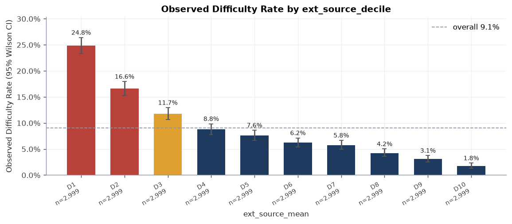

`reports/figures/eda_rate_ext_source_decile.png`

## 8. 보조 테이블 집계 Feature와 TARGET

집계 Feature의 NULL은 해당 원천에 이력이 없음을 의미하므로 0과 구분한다. 수치 비교는 이력 보유 고객(non-NULL) 내에서 수행했고, 이력 보유 여부 자체는 아래 has_* 표로 따로 비교한다.

| feature | 이력 보유율 | median (T=1) | median (T=0) | rank-biserial r | effect |
|---|---|---|---|---|---|
| cc_utilization_mean | 26.5% | 0.418 | 0.318 | +0.440 | 중간 |
| pos_dpd_month_ratio | 86.8% | 0.053 | 0.005 | +0.284 | 작음 |
| bur_bb_dpd_month_ratio | 78.9% | 0.056 | 0.026 | +0.274 | 작음 |
| inst_late_ratio | 86.8% | 0.120 | 0.077 | +0.252 | 작음 |
| pos_dpd_max | 86.8% | 44.000 | 0.500 | +0.225 | 작음 |
| cc_dpd_max | 26.5% | 0.000 | 0.000 | +0.219 | 작음 |
| inst_underpaid_ratio | 86.8% | 0.065 | 0.038 | +0.187 | 작음 |
| inst_severe_late_ratio | 86.8% | 0.053 | 0.028 | +0.170 | 작음 |
| inst_payment_ratio_mean | 86.8% | 0.977 | 0.989 | -0.170 | 작음 |
| inst_dpd_max | 86.8% | 41.000 | 33.000 | +0.146 | 작음 |
| prev_refused_ratio | 94.0% | 0.200 | 0.167 | +0.108 | 작음 |
| prev_approved_ratio | 94.0% | 0.571 | 0.625 | -0.072 | 무시할 수준 |
| bur_overdue_now_count | 85.6% | 0.000 | 0.000 | +0.026 | 무시할 수준 |
| bur_day_overdue_max | 85.6% | 0.000 | 0.000 | +0.025 | 무시할 수준 |
| bur_count | 85.6% | 5.000 | 5.000 | +0.016 | 무시할 수준 |
| prev_count | 94.0% | 4.000 | 4.000 | +0.007 | 무시할 수준 |
| bur_active_count | 85.6% | 2.000 | 2.000 | -0.005 | 무시할 수준 |
| bur_active_debt_credit_ratio | 71.0% | 0.440 | 0.440 | +0.002 | 무시할 수준 |

**이력 보유 여부별 관측 상환곤란율**

| flag | 보유 비중 | 보유 시 rate | 미보유 시 rate | Cramér's V |
|---|---|---|---|---|
| has_bureau | 85.6% | 9.0% | 9.3% | 0.004 |
| has_previous | 94.0% | 9.1% | 8.6% | 0.004 |
| has_installments | 86.8% | 9.0% | 9.6% | 0.007 |
| has_pos_cash | 86.8% | 9.0% | 9.6% | 0.007 |
| has_credit_card | 26.5% | 8.8% | 9.1% | 0.005 |

### inst_late_ratio_band

Cramér's V = 0.132

| 구간 | n | TARGET=1 | rate | 95% CI low | 95% CI high | 고객 비중 | Exposure 비중 |
|---|---|---|---|---|---|---|---|
| No history | 3,969 | 381 | 9.60% | 8.72% | 10.56% | 13.2% | 13.2% |
| 0 | 6,851 | 430 | 6.28% | 5.73% | 6.88% | 22.8% | 22.9% |
| 0-5% | 2,693 | 144 | 5.35% | 4.56% | 6.26% | 9.0% | 9.1% |
| 5-20% | 13,550 | 1,181 | 8.72% | 8.25% | 9.20% | 45.2% | 45.1% |
| >20% | 2,937 | 580 | 19.75% | 18.35% | 21.23% | 9.8% | 9.7% |

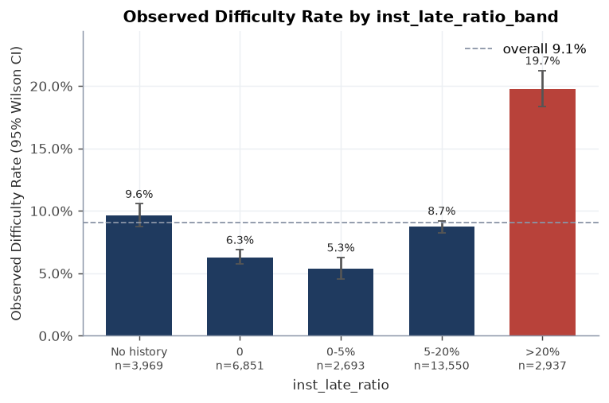

`reports/figures/eda_rate_inst_late_ratio_band.png`

### prev_refused_ratio_band

Cramér's V = 0.056

| 구간 | n | TARGET=1 | rate | 95% CI low | 95% CI high | 고객 비중 | Exposure 비중 |
|---|---|---|---|---|---|---|---|
| No history | 1,814 | 156 | 8.60% | 7.40% | 9.98% | 6.0% | 6.1% |
| 0 | 11,540 | 865 | 7.50% | 7.03% | 7.99% | 38.5% | 38.3% |
| 0-25% | 8,144 | 738 | 9.06% | 8.46% | 9.70% | 27.1% | 27.3% |
| 25-50% | 7,023 | 758 | 10.79% | 10.09% | 11.54% | 23.4% | 23.5% |
| >50% | 1,479 | 199 | 13.46% | 11.81% | 15.29% | 4.9% | 4.8% |

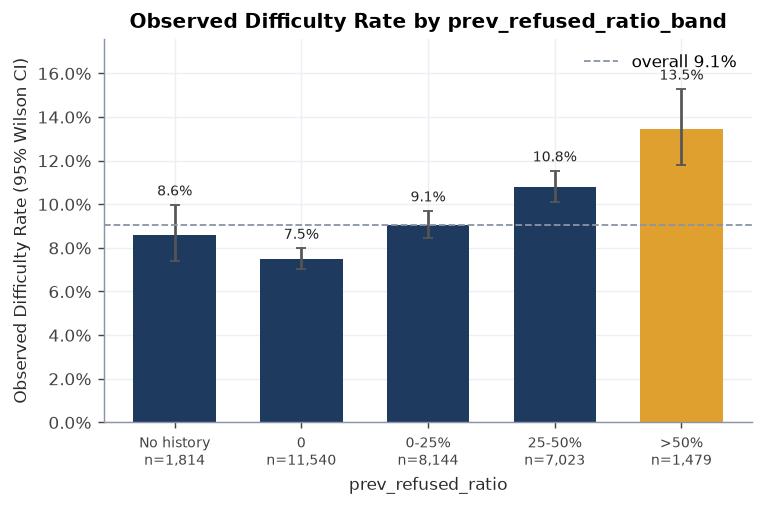

`reports/figures/eda_rate_prev_refused_ratio_band.png`

### bureau_worst_status

Cramér's V = 0.088

| 구간 | n | TARGET=1 | rate | 95% CI low | 95% CI high | 고객 비중 | Exposure 비중 |
|---|---|---|---|---|---|---|---|
| No history | 6,400 | 586 | 9.16% | 8.47% | 9.89% | 21.3% | 21.3% |
| Status 0 | 8,761 | 535 | 6.11% | 5.62% | 6.63% | 29.2% | 29.3% |
| Status 1 | 9,389 | 855 | 9.11% | 8.54% | 9.71% | 31.3% | 31.6% |
| Status 2 | 2,401 | 309 | 12.87% | 11.59% | 14.27% | 8.0% | 7.9% |
| Status 3 | 1,448 | 205 | 14.16% | 12.46% | 16.05% | 4.8% | 4.6% |
| Status 4 | 946 | 140 | 14.80% | 12.68% | 17.20% | 3.2% | 3.1% |
| Status 5 | 655 | 86 | 13.13% | 10.76% | 15.93% | 2.2% | 2.2% |

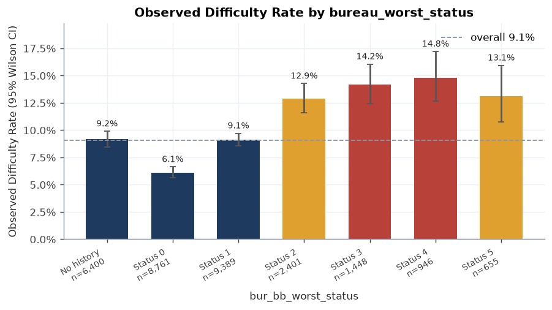

`reports/figures/eda_rate_bureau_worst_status.png`

## 9. 결측 자체와 TARGET의 관계

mart 컬럼 267개 중 결측이 존재하는 195개에 대해 NULL 여부와 TARGET의 2x2 교차표 Chi-square(희소 시 Fisher)를 SQL 집계 결과로 계산했다. 아래 표는 결측 비율 1% 이상인 179개 컬럼 중 효과크기 상위 20개다 (소표본 결측의 극단 비율 배제). `structural`=집계 원천 이력 부재.

| column | n (NULL) | null 비율 | structural | rate (NULL) | rate (값 있음) | phi / V |
|---|---|---|---|---|---|---|
| prev_days_since_last_refused | 13,354 | 44.5% | Y | 7.6% | 10.2% | 0.044 |
| name_type_suite | 502 | 1.7% |  | 5.2% | 9.1% | 0.018 |
| own_car_age | 19,828 | 66.1% |  | 9.2% | 8.7% | 0.009 |
| floorsmin_medi | 17,355 | 57.9% |  | 9.3% | 8.8% | 0.008 |
| entrances_mode | 17,318 | 57.7% |  | 9.3% | 8.8% | 0.008 |
| prev_rate_interest_privileged_max | 29,616 | 98.7% | Y | 9.1% | 7.0% | 0.008 |
| employment_age_ratio | 5,348 | 17.8% |  | 8.6% | 9.2% | 0.008 |
| days_employed_clean | 5,348 | 17.8% |  | 8.6% | 9.2% | 0.008 |
| employment_years | 5,348 | 17.8% |  | 8.6% | 9.2% | 0.008 |
| prev_amt_credit_approved_max | 3,331 | 11.1% | Y | 9.7% | 9.0% | 0.008 |
| prev_credit_application_ratio_mean | 3,331 | 11.1% | Y | 9.7% | 9.0% | 0.008 |
| prev_amt_credit_approved_mean | 3,331 | 11.1% | Y | 9.7% | 9.0% | 0.008 |
| prev_amt_credit_approved_sum | 3,331 | 11.1% | Y | 9.7% | 9.0% | 0.008 |
| prev_insured_ratio | 3,331 | 11.1% | Y | 9.7% | 9.0% | 0.008 |
| prev_days_since_last_approved | 3,331 | 11.1% | Y | 9.7% | 9.0% | 0.008 |
| apartments_avg | 17,363 | 57.9% |  | 9.2% | 8.8% | 0.008 |
| pos_dpd_month_ratio_6m | 3,969 | 13.2% | Y | 9.6% | 9.0% | 0.007 |
| pos_completed_loan_count | 3,969 | 13.2% | Y | 9.6% | 9.0% | 0.007 |
| pos_instalment_future_latest_sum | 3,969 | 13.2% | Y | 9.6% | 9.0% | 0.007 |
| inst_missed_count | 3,969 | 13.2% | Y | 9.6% | 9.0% | 0.007 |

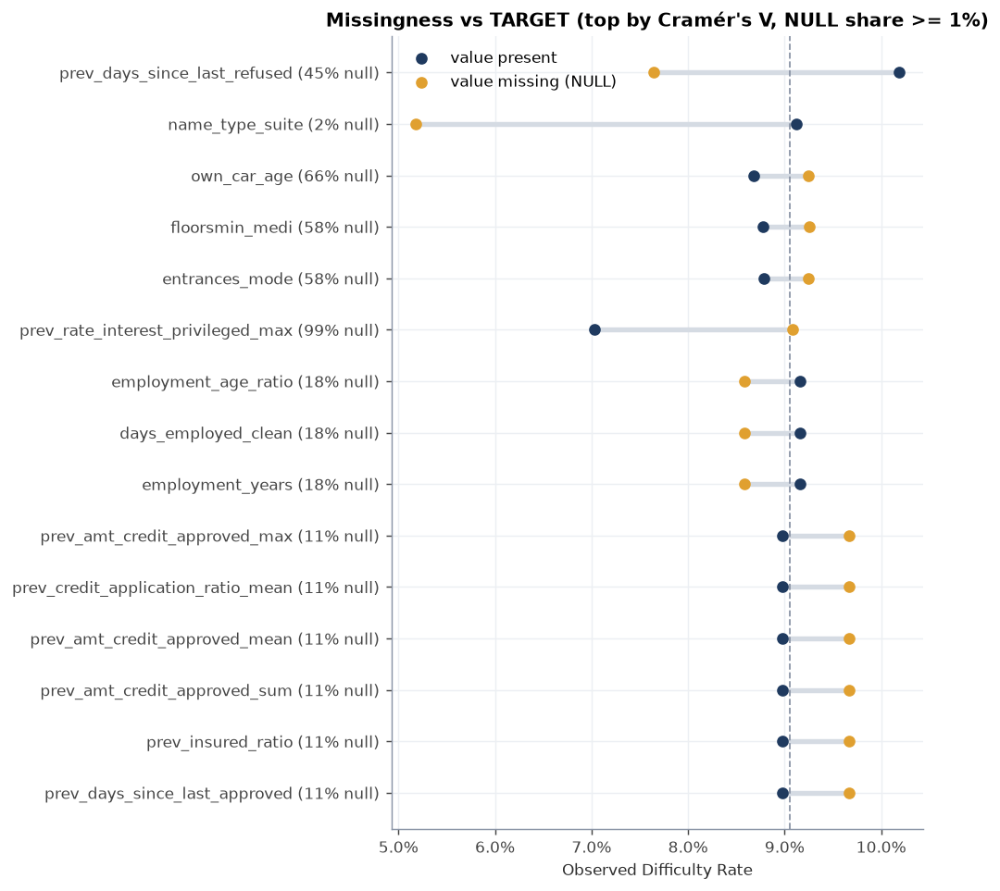

`reports/figures/eda_missingness_vs_target.png`

## 10. Exposure Proxy (AMT_CREDIT) 기준 위험 집중도

- 총 Exposure Proxy: 17,506,272,500, 고객 중앙값 487,250
- 상위 10% 고객의 Exposure 비중 24.7%, 상위 1% 4.2%, Gini 0.328
- `ext_source_mean` 하위 20%(≤ 0.300) 고객: Exposure 비중 19.8%, 관측 상환곤란 건 비중 45.7%, rate 20.7% vs 나머지 6.1%

세그먼트별로 관측 상환곤란율 (Observed Difficulty Rate)이 전체의 1.2배 이상이고 n ≥ 150인 구간을 'elevated'로 정의해 고객 비중과 Exposure 비중을 비교한다.

| segment | elevated groups | 고객 비중 | Exposure 비중 | 상환곤란 건 비중 | rate |
|---|---|---|---|---|---|
| income_band | < 100K | 18.5% | 18.5% | 23.5% | 11.5% |
| ext_source_quintile | Q1 | 20.0% | 19.8% | 45.7% | 20.7% |
| name_income_type | - | 0.0% | 0.0% | 0.0% | n/a |
| occupation_type | Drivers | 3.2% | 3.2% | 3.8% | 11.0% |
| name_education_type | - | 0.0% | 0.0% | 0.0% | n/a |
| name_housing_type | Office apartment | 0.8% | 0.8% | 1.1% | 11.8% |
| name_contract_type | - | 0.0% | 0.0% | 0.0% | n/a |
| age_band ⚖️ | 18-25 | 6.1% | 6.1% | 9.1% | 13.4% |

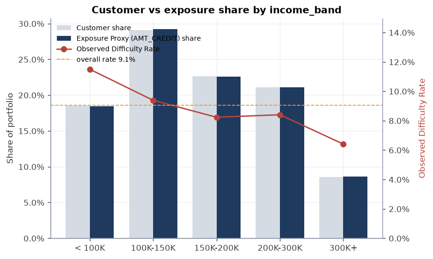

`reports/figures/eda_exposure_income_band.png`

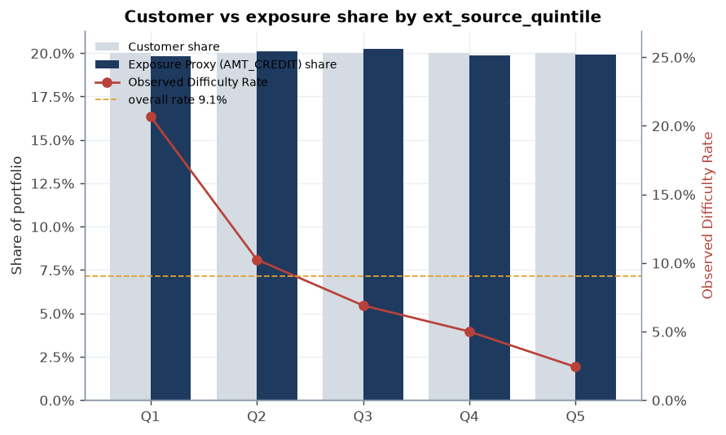

`reports/figures/eda_exposure_ext_source_quintile.png`

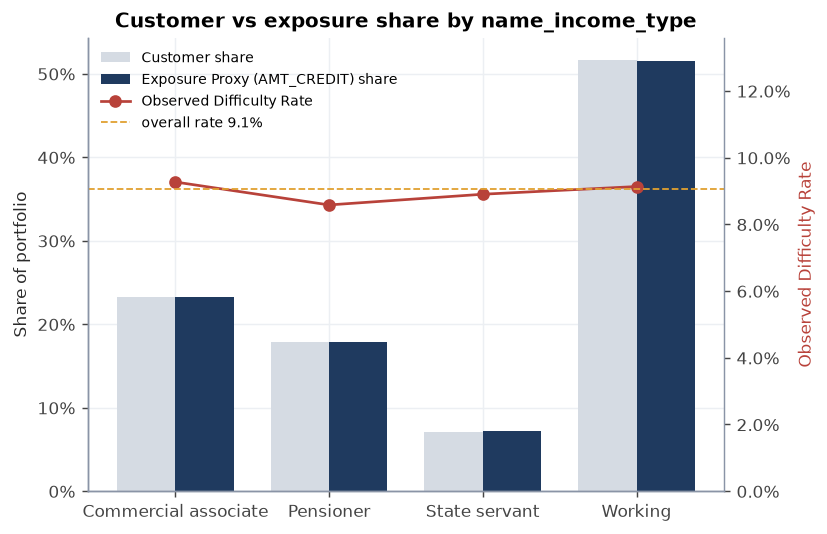

`reports/figures/eda_exposure_name_income_type.png`

## 11. 상관관계·중복 Feature 점검

mart 수치형 컬럼 246개를 md5 정렬 결정적 표본 30,000행으로 Pearson 상관을 계산했다. |r| > 0.9 쌍: **33개**. 모델링 단계에서 중복 Feature 제거 또는 정규화(L2/트리 모델) 근거로 사용한다.

| feature A | feature B | r |
|---|---|---|
| days_registration | days_registration_years | -1.000 |
| def_30_cnt_social_circle | def_60_cnt_social_circle | +1.000 |
| days_employed | days_employed_clean | +1.000 |
| obs_30_cnt_social_circle | obs_60_cnt_social_circle | +1.000 |
| region_rating_client | region_rating_client_w_city | +1.000 |
| has_installments | has_pos_cash | +1.000 |
| inst_loan_count | pos_loan_count | +1.000 |
| flag_emp_phone | days_employed_anom | -1.000 |
| days_employed | employment_years | -1.000 |
| days_employed_clean | employment_years | -1.000 |
| days_last_phone_change | phone_change_years | -1.000 |
| days_id_publish | days_id_publish_years | -1.000 |
| days_birth | age_years | -1.000 |
| days_employed | days_employed_anom | +1.000 |
| days_employed | flag_emp_phone | -1.000 |
| amt_credit | amt_goods_price | +0.993 |
| bur_debt_total | bur_active_debt_total | +0.991 |
| cc_utilization_mean | cc_utilization_mean_12m | +0.977 |
| pos_dpd_max | pos_dpd_def_max | +0.960 |
| cc_limit_mean | cc_limit_max | +0.959 |
| pos_cnt_instalment_mean | pos_instalment_future_latest_mean | +0.958 |
| employment_years | employment_age_ratio | +0.937 |
| days_employed | employment_age_ratio | -0.937 |
| days_employed_clean | employment_age_ratio | -0.937 |
| prev_approved_count | pos_loan_count | +0.931 |
| prev_approved_count | inst_loan_count | +0.931 |
| inst_dpd_mean | inst_severe_late_ratio | +0.922 |
| ext_source_mean | ext_source_max | +0.922 |
| ext_source_mean | ext_source_min | +0.922 |
| prev_amt_credit_approved_max | prev_amt_credit_approved_sum | +0.921 |

… 외 3쌍 (`reports/eda_results.json`의 `corr_pairs`).

**다중공선성 참고 — VIF (주요 신청 Feature, 완전 관측 행 기준)**

| feature | VIF |
|---|---|
| amt_credit | 87.6 |
| amt_goods_price | 74.1 |
| amt_annuity | 18.0 |
| annuity_income_ratio | 17.2 |
| credit_income_ratio | 16.5 |
| ext_source_mean | 4.0 |
| ext_source_2 | 3.8 |
| credit_annuity_ratio | 2.7 |
| amt_income_total | 1.8 |
| region_rating_client | 1.1 |
| age_years | 1.0 |

VIF > 10은 강한 다중공선성 신호로, 선형 모델 해석 시 주의한다.

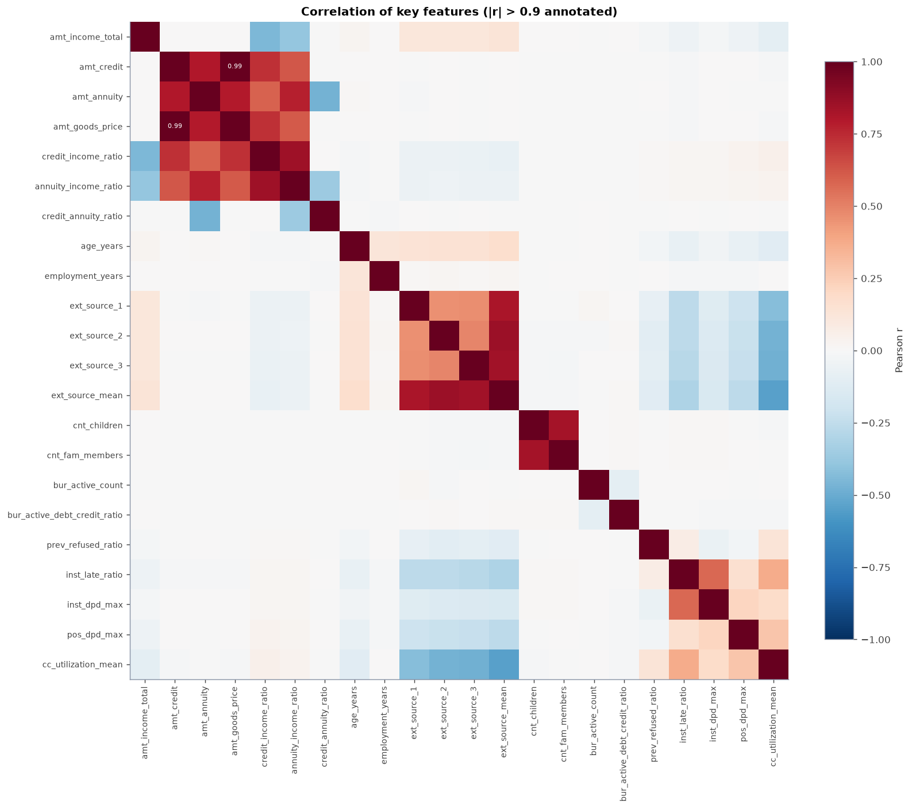

`reports/figures/eda_correlation_heatmap.png`

## 12. 공정성·윤리 고지

- 성별(code_gender), 연령(age_years/age_band), 가족 상태(name_family_status), 자녀·가구원 수는 기술통계로만 제시했으며 핵심 인사이트 후보에서 제외했다. 이 속성들을 승인 자동화 근거로 사용하지 않는다.
- 본 분석은 교육·포트폴리오 목적이며, 실제 금융 의사결정에는 법률·규제·공정성 검토와 독립 검증이 필요하다.
- 관측된 연관은 인과관계가 아니다.
