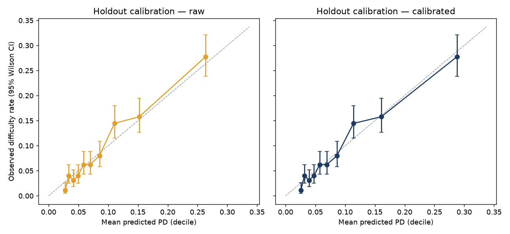
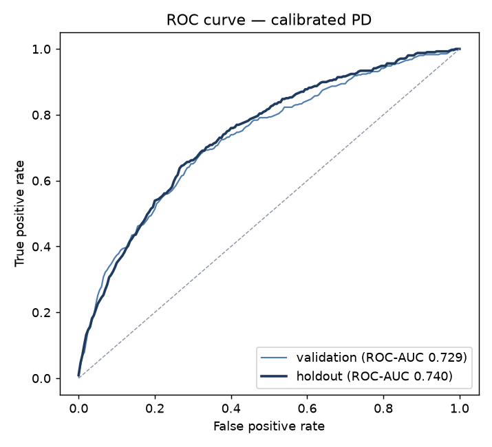
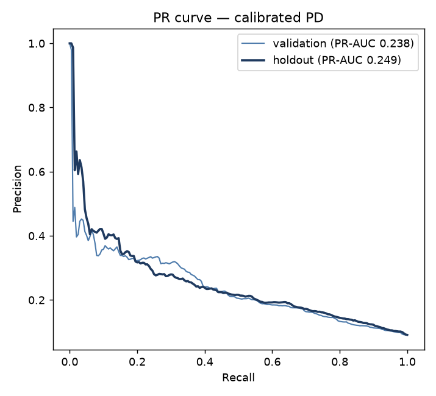
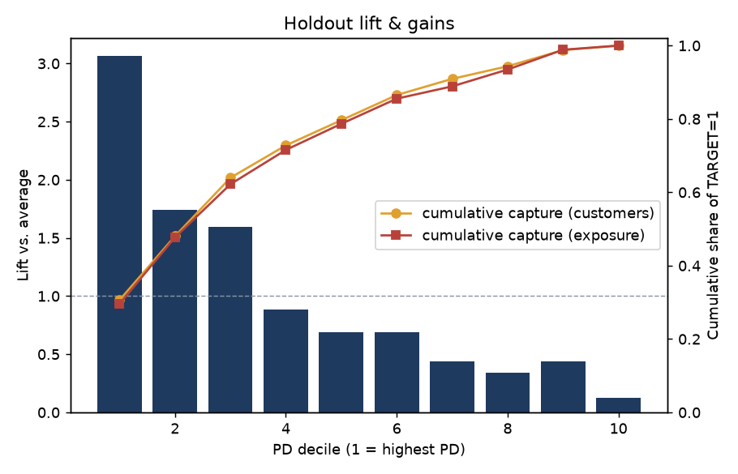

# Model Card — pd-lgbm-fv1.0-a6c83074-s42

> ⚠️ **합성(synthetic) 테스트 데이터 기반 결과 — 실제 Home Credit 분석 결과 아님.** 실제 Kaggle 데이터를 `data/raw/`에 넣고 `./scripts/run_all.ps1`을 실행하면 이 문서가 재생성됩니다.

_자동 생성: `credit_risk.train` (2026-10-16 03:08). 모든 수치는 실행 결과에서 기입됨._

## 1. Intended use / Out-of-scope
- **용도:** 교육·포트폴리오 목적의 여신 포트폴리오 위험 모니터링. 고객별 **proxy PD**를 Exposure proxy 및 가정 LGD와 결합해
  Power BI에서 위험 집중도와 손실 시나리오를 탐색한다.
- **범위 외:** 실제 승인/거절 자동화, 가격 결정, IFRS 9 ECL·Basel 규제자본 산출, 개인에 대한 불이익 결정.
  성별·연령·가족상태 등은 진단용으로만 사용하며 승인 근거로 권고하지 않는다.

## 2. 데이터와 TARGET
- 원천: Kaggle *Home Credit Default Risk* `application_train.csv` 및 7개 관계형 이력 파일.
- `TARGET=1`은 대출 초기 기간 중 일정 일수 이상 연체가 관측되는 등 **상환 곤란이 관측된 고객**을 뜻한다.
  장기 생애부도·법적 파산·회계상 Stage 3와 동일하지 않다. 따라서 모델 출력은 **Home Credit TARGET을 예측한 proxy PD**이다.
- 모집단: application_train 고객 30,000명. `application_test`는 무라벨 scoring 예시로만 사용.

## 3. Split
- Stratified Train/Validation/Holdout = 70/15/15, seed `42` → {'train': 21000, 'validation': 4500, 'holdout': 4500}.
- 신뢰할 수 있는 달력 시점이 없어 시간 기반 분할이라고 주장하지 않는다. 고객 ID 교집합 0을 자동 검사한다.
- 모든 전처리(대치·클리핑·스케일링·인코딩)는 sklearn Pipeline 내부에서 **Train split에만 fit**한다.
  LightGBM early stopping은 Train 내부 10% slice로 수행(Validation·Holdout 미사용).

## 4. Features
- 266개 (numeric 248, categorical 18), 정책: `configs/features.yaml`.
- 자동 누수 검사: 제외 목록·label-like 이름 차단 + 단일 Feature AUC 상한(0.95).
  결과: 최대 단일 Feature AUC = 0.7154 (`ext_source_mean`).
- 상세 검토: `reports/leakage_review.md`, 사전: `reports/data_dictionary.md`.

## 5. 모델과 선택
- Baseline 0: Train 평균 관측률 / Baseline 1: Logistic Regression (L2, C=0.1, 표준화)
  / Champion 후보: LightGBM (early-stopped trees = 91).
- 선택 기준: **Validation ROC-AUC** (Holdout은 선택에 사용하지 않음). Champion = **lightgbm**
  (LogReg 대비 Validation AUC +0.0201).
- 불균형 처리: class weight·SMOTE 미사용 — 확률 해석력을 유지하고, 순위 성능은 PR-AUC로 함께 보고.

| Model | Split | ROC-AUC | PR-AUC | Log Loss | Brier | KS | Mean PD | Observed rate |
|---|---|---:|---:|---:|---:|---:|---:|---:|
| baseline_mean (raw) | validation | 0.5000 | 0.0904 | 0.3036 | 0.0823 | 0.0000 | 9.05% | 9.04% |
| baseline_mean (raw) | holdout | 0.5000 | 0.0907 | 0.3041 | 0.0824 | 0.0000 | 9.05% | 9.07% |
| logistic_regression (raw) | validation | 0.7085 | 0.2171 | 0.2819 | 0.0779 | 0.3102 | 9.07% | 9.04% |
| logistic_regression (raw) | holdout | 0.7278 | 0.2341 | 0.2761 | 0.0769 | 0.3548 | 9.17% | 9.07% |
| lightgbm (raw) | validation | 0.7286 | 0.2384 | 0.2736 | 0.0762 | 0.3620 | 8.79% | 9.04% |
| lightgbm (raw) | holdout | 0.7397 | 0.2490 | 0.2724 | 0.0761 | 0.3768 | 8.93% | 9.07% |
| lightgbm (calibrated) ★ champion | validation | 0.7286 | 0.2384 | 0.2734 | 0.0761 | 0.3620 | 9.04% | 9.04% |
| lightgbm (calibrated) ★ champion | holdout | 0.7397 | 0.2490 | 0.2721 | 0.0761 | 0.3768 | 9.20% | 9.07% |

## 6. Calibration
Validation 내부 5-fold CV로 비교, 선택 = **sigmoid** (Holdout에는 fit하지 않음).
`predicted_pd_raw`(교정 전)와 `predicted_pd`(교정 후)를 모두 저장한다.

| Method | CV Brier | CV Log Loss | CV mean PD | Observed rate |
|---|---:|---:|---:|---:|
| none | 0.07615 | 0.27363 | 0.0879 | 0.0904 |
| sigmoid | 0.07624 | 0.27388 | 0.0905 | 0.0904 |
| isotonic | 0.07654 | 0.28037 | 0.0904 | 0.0904 |

Holdout calibration-in-the-large (mean PD − observed): 0.0013.

## 7. Threshold
- 정책: **review capacity** — Validation에서 PD 상위 10%를 수기 심사 대상으로 지정하는 컷오프를 고정.
- Selected threshold = **0.1942** → Holdout: precision 27.16%,
  recall 30.88%, F1 0.2890, flagged 10.31%,
  TARGET=1 Exposure capture 29.79%.
- Confusion matrix (Holdout): TP 126 · FP 338 ·
  FN 282 · TN 3,754.
- Top-decile lift 3.064, top-decile capture 30.64%.

 

## 8. Explainability (association ≠ causation)
Champion SHAP (Holdout 표본 4,500명):

| Rank | Feature | mean abs SHAP | Direction (descriptive) |
|---:|---|---:|---|
| 1 | `ext_source_mean` | 0.2001 | higher value -> lower PD |
| 2 | `ext_source_max` | 0.1198 | higher value -> lower PD |
| 3 | `ext_source_min` | 0.0938 | higher value -> lower PD |
| 4 | `ext_source_3` | 0.0646 | higher value -> lower PD |
| 5 | `pos_dpd_month_ratio` | 0.0420 | higher value -> higher PD |
| 6 | `bur_bb_dpd_month_ratio` | 0.0382 | higher value -> higher PD |
| 7 | `region_rating_client` | 0.0360 | higher value -> higher PD |
| 8 | `ext_source_2` | 0.0300 | higher value -> lower PD |
| 9 | `inst_late_ratio` | 0.0300 | higher value -> higher PD |
| 10 | `organization_type` | 0.0277 | categorical / mixed |
| 11 | `inst_late_count` | 0.0261 | higher value -> higher PD |
| 12 | `inst_underpaid_ratio` | 0.0233 | higher value -> higher PD |
| 13 | `pos_dpd_month_ratio_12m` | 0.0210 | higher value -> higher PD |
| 14 | `bur_bb_dpd_months_total` | 0.0205 | higher value -> higher PD |
| 15 | `inst_dpd_mean` | 0.0195 | higher value -> higher PD |

Logistic Regression 상위 계수 (표준화 입력 1 SD 기준 odds ratio):

| Term | Coefficient | Odds ratio / SD |
|---|---:|---:|
| `cat__name_type_suite_Spouse, partner` | +0.2762 | 1.318 |
| `cat__name_type_suite_MISSING` | -0.2677 | 0.765 |
| `num__bur_bb_dpd_months_total` | +0.2633 | 1.301 |
| `num__ext_source_max` | -0.2322 | 0.793 |
| `cat__occupation_type_Security staff` | +0.2264 | 1.254 |
| `num__cc_utilization_mean` | +0.2247 | 1.252 |
| `cat__occupation_type_Realty agents` | -0.2241 | 0.799 |
| `num__cc_limit_max` | -0.2137 | 0.808 |
| `num__missingindicator_bur_enddate_max` | +0.2132 | 1.238 |
| `cat__name_type_suite_Other_B` | -0.2095 | 0.811 |

고객별 상위 3개 reason code(PD를 높인 방향의 기여)는 `analytics.reason_codes`에 저장된다. 기여도는 모델 내부의 연관 설명이며 인과 효과가 아니다.

## 9. Segment / fairness diagnostics (Holdout)
차별의 증명이 아니라 모델 차이를 진단하기 위한 표이다. 소표본(n < 500) 그룹은 해석에 주의.

| Attribute | Group | n | Observed | Mean PD | AUC | Recall@thr | Note |
|---|---|---:|---:|---:|---:|---:|---|
| code_gender | F | 2,963 | 9.35% | 9.24% | 0.730 | 28.88% |  |
| code_gender | M | 1,537 | 8.52% | 9.13% | 0.760 | 35.11% |  |
| age_band | 18-24 | 247 | 11.74% | 12.56% | 0.730 | 48.28% | ⚠️ 소표본 |
| age_band | 25-34 | 762 | 8.92% | 10.25% | 0.712 | 29.41% |  |
| age_band | 35-44 | 1,422 | 9.99% | 9.75% | 0.750 | 33.80% |  |
| age_band | 45-54 | 1,314 | 8.90% | 8.53% | 0.749 | 29.06% |  |
| age_band | 55-64 | 584 | 7.02% | 7.23% | 0.698 | 17.07% |  |
| age_band | 65+ | 171 | 6.43% | 7.03% | 0.738 | 27.27% | ⚠️ 소표본 |
| name_family_status | Civil marriage | 458 | 9.61% | 9.35% | 0.749 | 34.09% | ⚠️ 소표본 |
| name_family_status | Married | 2,904 | 8.85% | 9.23% | 0.749 | 31.13% |  |
| name_family_status | Separated | 284 | 10.56% | 8.24% | 0.695 | 13.33% | ⚠️ 소표본 |
| name_family_status | Single / not married | 645 | 9.61% | 9.15% | 0.715 | 30.65% |  |
| name_family_status | Widow | 209 | 7.18% | 9.96% | 0.792 | 53.33% | ⚠️ 소표본 |
| name_education_type | Academic degree | 2 | 0.00% | 4.36% | n/a | 0.00% | ⚠️ 소표본 |
| name_education_type | Higher education | 1,062 | 8.66% | 9.17% | 0.765 | 34.78% |  |
| name_education_type | Incomplete higher | 168 | 8.93% | 8.85% | 0.855 | 33.33% | ⚠️ 소표본 |
| name_education_type | Lower secondary | 59 | 8.47% | 9.26% | 0.507 | 20.00% | ⚠️ 소표본 |
| name_education_type | Secondary / secondary special | 3,209 | 9.22% | 9.23% | 0.730 | 29.73% |  |

## 10. Limitations & ethics
- TARGET·Exposure(AMT_CREDIT)·LGD(가정 45%)가 모두 proxy/가정이므로 Expected Loss는 **시나리오 지표**이며 충당금·규제자본이 아니다.
- 학습 표본은 Home Credit 신청자 표본이며 다른 고객군에 일반화하지 않는다. 승인된 고객만 결과가 관측되는 reject bias가 존재할 수 있다.
- 실제 운영 적용 전에는 법률·규제·공정성 검토와 독립 모델 검증이 필요하다.

## 11. Versioning
- model_version `pd-lgbm-fv1.0-a6c83074-s42` · feature_version `fv1.0` · artifact `models\pd-lgbm-fv1.0-a6c83074-s42.joblib`
- 재로딩 예측 최대 차이 0.00e+00 (허용 1e-9) · 학습 시간(초) {'baseline_mean': 0.0, 'logistic_regression': 1.8, 'lightgbm': 2.4}
- 재학습: `./scripts/train.ps1` (동일 데이터·seed·config → 동일 version 문자열).
