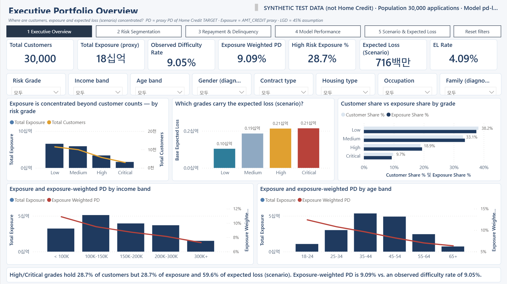
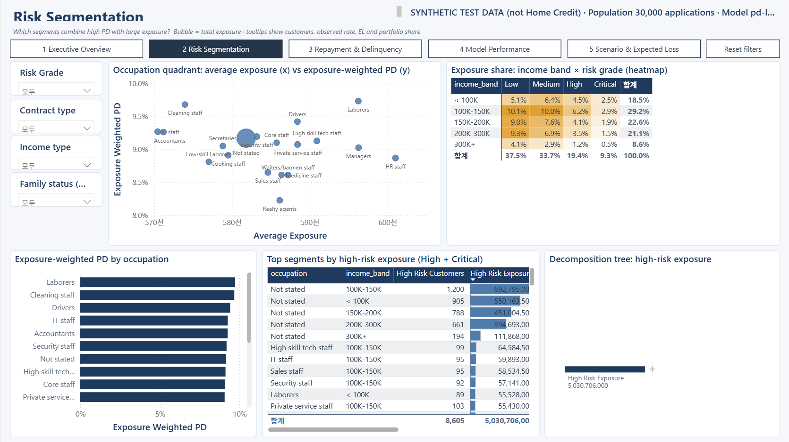
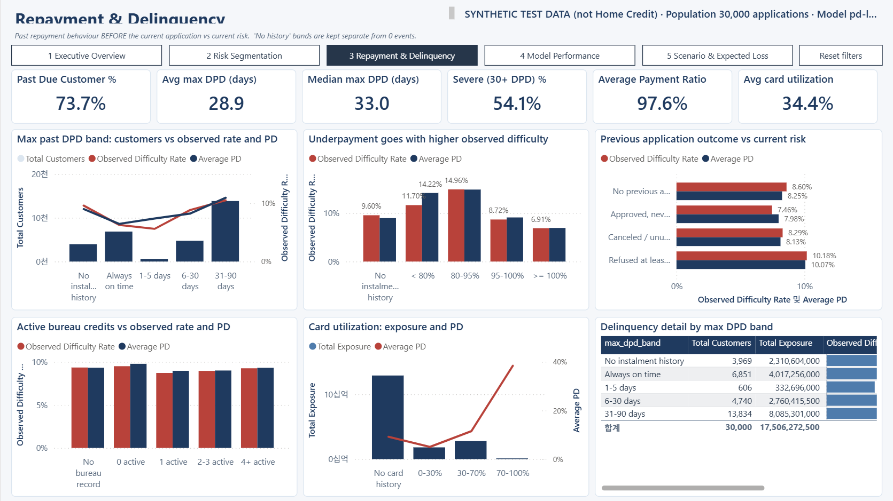
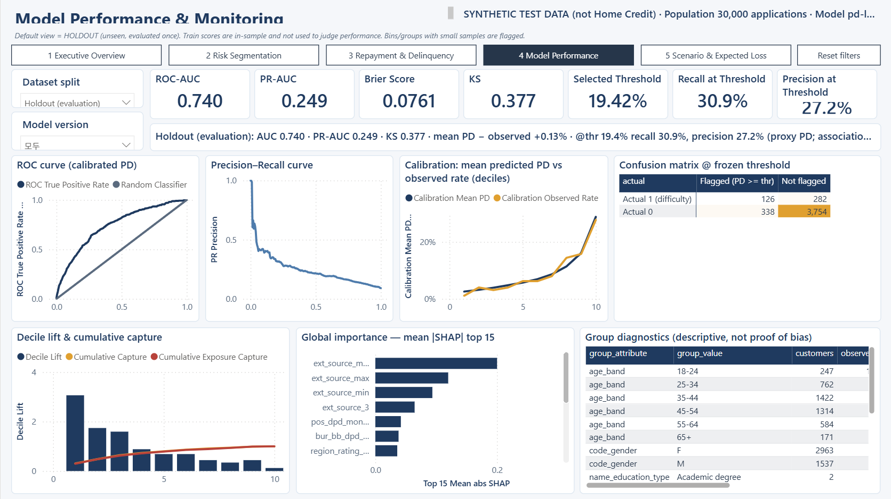
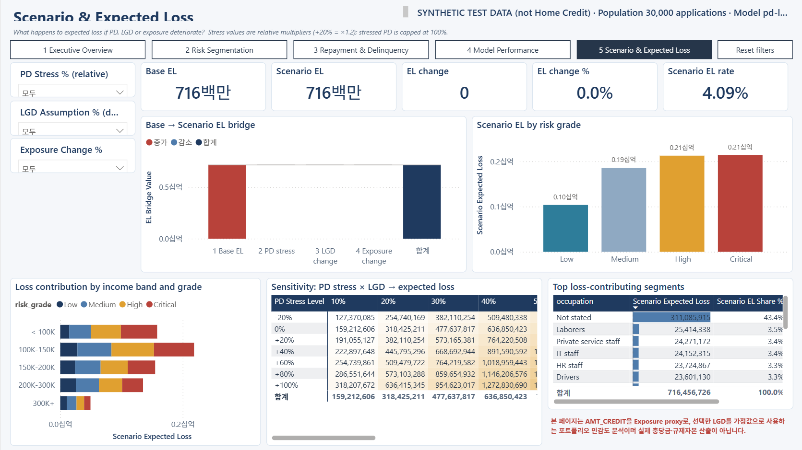

# Power BI Validation

> ⚠️ **합성(synthetic) 테스트 데이터 기반 결과 — 실제 Home Credit 분석 결과 아님.** 실제 Kaggle 데이터를 `data/raw/`에 넣고 `./scripts/run_all.ps1`을 실행하면 이 문서가 재생성됩니다.

_자동 생성: `credit-risk powerbi-validation` (2026-10-16 03:20)._

## 방법
1. `scripts/validate_tmdl.ps1` — 생성된 TMDL을 Power BI Desktop의 `TmdlSerializer`로 파싱 (구문·참조 오류 검출)
2. `scripts/validate_pbir.py` — 보고서 JSON 전체를 Microsoft 공식 PBIR JSON Schema로 검증
3. `scripts/validate_powerbi.ps1` — 시맨틱 모델을 실행 중인 Power BI Desktop 로컬 엔진에 임시 DB로 배포 → Full refresh →
   DAX 쿼리 실행 (CSV 스냅샷 모드, 자격증명 불필요)
4. 이 문서 — DAX 결과를 SQL mart 뷰(`mart.v_kpi_portfolio`, `v_kpi_by_grade`, `v_scenario_sensitivity`) 및 학습 실행 지표와 대조
5. `scripts/open_check.ps1` + `scripts/capture_pages.ps1` — PBIP를 Desktop에서 열어 오류 대화상자 부재 확인 후 5개 페이지 캡처

## 결과: 42/42 일치 (상대 오차 허용 1e-09)
- 새로고침: 21/21 테이블 `Ready` 

| Check | DAX (Power BI engine) | SQL / Python | Match |
|---|---:|---:|:---:|
| Total Customers | 30,000 | 30,000 | ✅ |
| Total Exposure (proxy) | 17,506,272,500 | 17,506,272,500 | ✅ |
| Observed Difficulty Rate | 0.090533 | 0.090533 | ✅ |
| Average PD | 0.091588 | 0.091588 | ✅ |
| Exposure Weighted PD | 0.090946 | 0.090946 | ✅ |
| Base Expected Loss | 716,456,726 | 716,456,726 | ✅ |
| EL Rate | 0.040926 | 0.040926 | ✅ |
| High Risk Customer % | 0.286833 | 0.286833 | ✅ |
| High Risk Exposure % | 0.287366 | 0.287366 | ✅ |
| Risk Capture (Exposure) | 0.711956 | 0.711956 | ✅ |
| Past Due Customer % | 0.736814 | 0.736814 | ✅ |
| Severe Delinquency Customer % | 0.541355 | 0.541355 | ✅ |
| Average Payment Ratio | 0.976052 | 0.976052 | ✅ |
| Average Credit Utilization | 0.343568 | 0.343568 | ✅ |
| Grade High — customers | 5,682 | 5,682 | ✅ |
| Grade High — exposure | 3,401,503,500 | 3,401,503,500 | ✅ |
| Grade High — base EL | 212,769,856 | 212,769,856 | ✅ |
| Grade Low — customers | 11,469 | 11,469 | ✅ |
| Grade Low — exposure | 6,572,615,000 | 6,572,615,000 | ✅ |
| Grade Low — base EL | 103,651,928 | 103,651,928 | ✅ |
| Grade Medium — customers | 9,926 | 9,926 | ✅ |
| Grade Medium — exposure | 5,902,951,500 | 5,902,951,500 | ✅ |
| Grade Medium — base EL | 185,971,448 | 185,971,448 | ✅ |
| Grade Critical — customers | 2,923 | 2,923 | ✅ |
| Grade Critical — exposure | 1,629,202,500 | 1,629,202,500 | ✅ |
| Grade Critical — base EL | 214,063,495 | 214,063,495 | ✅ |
| Σ grades EL = total EL (DAX internal) | 716,456,726 | 716,456,726 | ✅ |
| Σ grades customers = total customers | 30,000 | 30,000 | ✅ |
| What-if defaults: Scenario EL = Base EL | 716,456,726 | 716,456,726 | ✅ |
| What-if defaults: Scenario EL change = 0 | 0.000000 | 0.000000 | ✅ |
| Stress (+20% PD, LGD 60%, −10% exposure): waterfall total = scenario EL | 1,146,330,761 | 1,146,330,761 | ✅ |
| Sensitivity matrix: 63 DAX cells vs SQL v_scenario_sensitivity (mismatches) | 0.000000 | 0.000000 | ✅ |
| Filter spot check (income 100K-150K × Female): customers | 5,759 | 5,759 | ✅ |
| Filter spot check: exposure | 3,398,663,000 | 3,398,663,000 | ✅ |
| Filter spot check: base EL | 144,935,484 | 144,935,484 | ✅ |
| Holdout roc_auc (DAX vs Python training run) | 0.739742 | 0.739742 | ✅ |
| Holdout pr_auc (DAX vs Python training run) | 0.248998 | 0.248998 | ✅ |
| Holdout brier (DAX vs Python training run) | 0.076092 | 0.076092 | ✅ |
| Holdout ks (DAX vs Python training run) | 0.376768 | 0.376768 | ✅ |
| Holdout recall (DAX vs Python training run) | 0.308824 | 0.308824 | ✅ |
| Holdout precision (DAX vs Python training run) | 0.271552 | 0.271552 | ✅ |
| Selected threshold | 0.194195 | 0.194195 | ✅ |

## Filter spot check (income 100K–150K × Female)
DAX: {"customers": 5759, "exposure": 3398663000, "ew_pd": 0.09476634000401693, "el": 144935484.03768253}
(SQL 대조 쿼리: `SELECT count(*), sum(exposure_proxy), sum(expected_loss) FROM mart.fact_customer_risk f JOIN mart.dim_customer_segment s USING (segment_key) WHERE s.income_band='100K-150K' AND s.gender='Female'`)

## Dynamic text
- Executive: High/Critical grades hold 28.7% of customers but 28.7% of exposure and 59.6% of expected loss (scenario). Exposure-weighted PD is 9.09% vs. an observed difficulty rate of 9.05%.
- Model: Holdout (evaluation): AUC 0.740 · PR-AUC 0.249 · KS 0.377 · mean PD − observed +0.13% · @thr 19.4% recall 30.9%, precision 27.2% (proxy PD; associations, not causes)
- Header: SYNTHETIC TEST DATA (not Home Credit) · Population 30,000 applications · Model pd-lgbm-fv1.0-a6c83074-s42 · Refreshed 2026-10-15 18:09 UTC

## 수동 확인이 필요한 항목
PBIP 자동 테스트로 확인할 수 없는 상호작용은 Desktop에서 직접 확인한다: slicer 교차 필터, tooltip 표시, page navigator 이동,
**Reset filters** 북마크 동작, Decomposition tree 확장. 위 DAX 대조는 동일 모델·동일 measure로 수행되었으므로 visual의 숫자는 표와 일치한다.

## Screenshots

